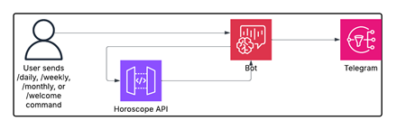
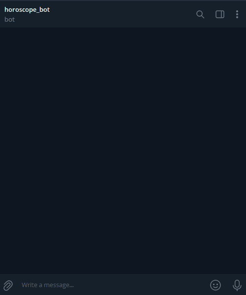
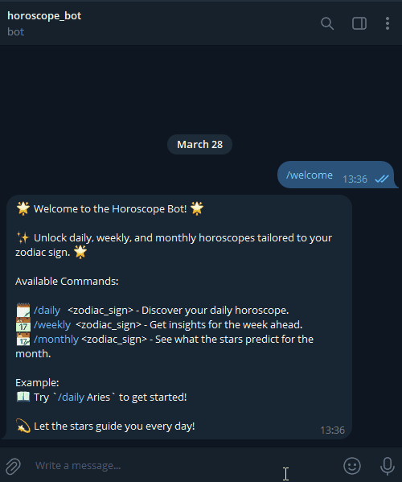
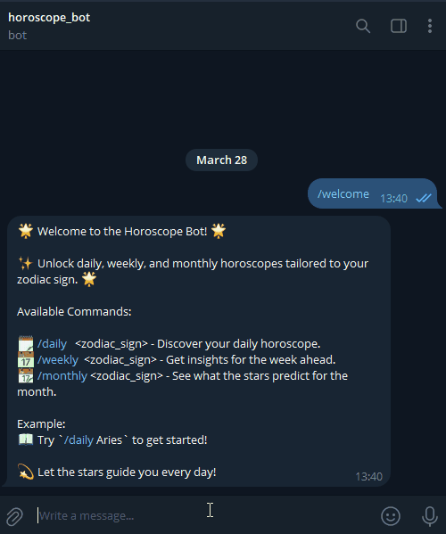
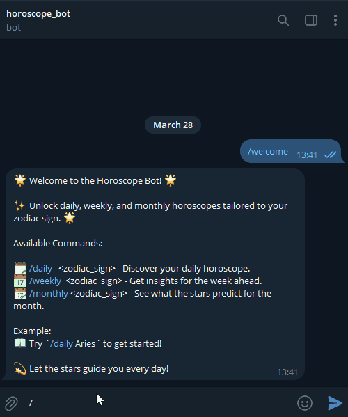

# 🌟 Horoscope Bot with Telegram Integration 🌟

**Welcome to the Horoscope Bot!**

**Horoscope Bot** is a Python-based Telegram bot that provides daily zodiac horoscopes using an API, all while being fully containerized with Docker.


---

## 🌀 How It Works


1. **User Interaction**: The user sends a `/horoscope <zodiac_sign>` command via Telegram.
2. **Validation**: The bot validates the zodiac sign and ensures it is a valid entry.
3. **API Request**: The bot makes an HTTP request to the Horoscope API to fetch the daily horoscope.
4. **Response**: The horoscope is formatted and sent back to the user as a message on Telegram.

---

## 📚 Table of Contents

1. [Features](#-features)
2. [Getting Started](#-getting-started)
    - [Prerequisites](#prerequisites)
    - [Installation](#installation)
    - [Set Environment Variables](#set-environment-variables)
3. [Running with Docker](#-running-with-docker)
4. [Using the Horoscope Bot](#-using-the-horoscope-bot)
5. [Application Overview](#-application-overview)
6. [Security Tips](#-security-tips)
7. [Contributing](#️-contributing)
8. [License](#-license)
9. [Acknowledgements](#-acknowledgements)

---

## 🧰 Tech Stack
- **Python**: Application logic and API interactions.
- **Docker**: Containerized environment for deployment.
- **Telegram Bot API**: User interaction and communication.

---

## 🚀 Getting Started

### Prerequisites
1. Install Docker: [Docker Installation Guide](https://docs.docker.com/get-docker/).
2. Create a Telegram bot via [BotFather](https://core.telegram.org/bots#botfather) and obtain the API token.

---

### Installation
1. Clone this repository:
   ```bash
   git clone <repository-url>
   cd <repository-folder>
   ```

### Set Environment Variables
Configure the Telegram bot token as an environment variable:

- **On Linux/macOS**:
   ```bash
   export TELEGRAM_TOKEN=your-telegram-token
   ```

- **On Windows**:
   ```bash
   set TELEGRAM_TOKEN=your-telegram-token
   ```

---

### Running with Docker
1. Build the Docker image:
```bash
docker build -t horoscope-api-bot .
```

2. Run the Docker container:
```bash
docker run -e TELEGRAM_TOKEN="your-telegram-token" -d horoscope-api-bot
```

---

### Using the Horoscope Bot
1. Start the bot in Telegram using /welcome



2. Fetch your daily horoscope with "/daily <zodiac_sign>"



3. Fetch your weekly horoscope with "/weekly <zodiac_sign>"



4. Fetch your monthly horoscope with "/monthly <zodiac_sign>"



---

## ❓ FAQ
**Q: What happens if I use an invalid zodiac sign?**
A: The bot will prompt you to use a valid zodiac sign, e.g., Aries, Taurus, etc.

**Q: How secure is my Telegram token?**
A: Your token is stored securely using environment variables or Docker secrets. It’s never exposed in code.

---

## 🌟 Acknowledgements
- [Horoscope API](https://horoscope-app-api.vercel.app/)
- [Python Telegram Bot Library](https://python-telegram-bot.org/)
- [Docker](https://www.docker.com/)

---

## 📬 Contact
For questions or suggestions, feel free to reach out at [guillermo.wich@outlook.com](mailto:guillermo.wich@outlook.com).

